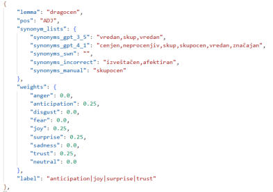
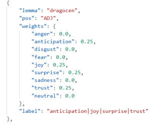
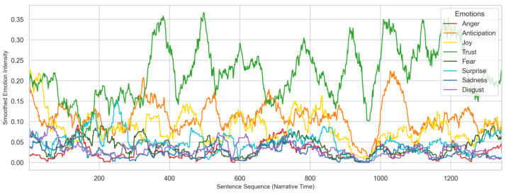
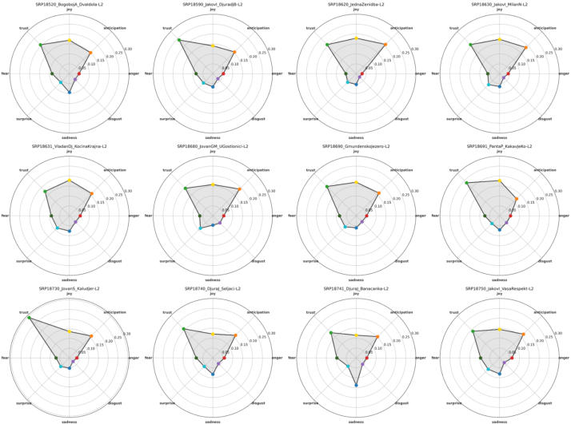
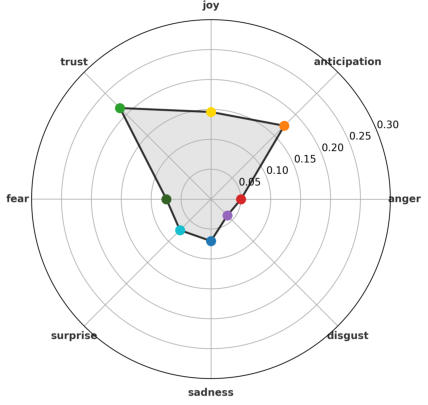

[](https://www.python.org/)
[](https://github.com/COST-ELTeC/ELTeC-srp)
[](https://live.european-language-grid.eu/catalogue/lcr/23616)
[](https://creativecommons.org/licenses/by/4.0/)

# 📄 Exploring Emotion Dynamics in the _SrpELTeC_ Literary Corpus

This repository contains the code and generated resources accompanying the study:

**Research paper:** [Lexicon-Based Exploration of Emotion Dynamics in TEI Novels: Case Study on SrpELTeC Corpus](https://dr.rgf.bg.ac.rs/files/original/b2b4bc348b99c4e08d3151d7955d6aa9e4d50a50.pdf) 
(In Serbian: **_Leksičko Istraživanje Emocionalne Dinamike u TEI Romanima: Studija Slučaja na Korpusu SrpELTeC_**)  
**Authors:** Ranka Stanković and Milena Šošić  
**Publication:** *Proceedings of the Second International Conference South Slavic Languages in the Digital Environment (JuDig 2026)*, Belgrade, 26–28 October 2026  
**DOI:** [10.18485/judig.2026.2.ch8](https://doi.org/10.18485/judig.2026.2.ch8)  

## ✨ About the Study

The study analyses Serbian novels from _SrpELTeC_ corpus encoded in TEI/XML and identifies emotion dynamics using Plutchik's eight basic emotions and the Serbian emotion lexicon _EmoLex.SR_.

- 📚 Processes TEI/XML novels from the level-2 SrpELTeC corpus;
- 🔤 Matches Serbian lemmas and part-of-speech (PoS) tag pairs against EmoLex.SR lexicon;
- 💠 Aggregates emotion scores at sentence, paragraph, chapter, literary work, and corpus level;
- 📈 Creates emotion trajectories, heatmaps, sentence curves, and corpus summaries;
- 🎯 Extracts passages and narrative points with the highest emotional charge;
- 🧮 Produces lemma-PoS frequency and emotion-contribution statistics;
- 🗂️ Writes interactive HTML reports with highlighted emotional words and tooltips.


## 🔗 Language resources

### SrpELTeC
- **ELTeC-srp corpus:** [COST-ELTeC/ELTeC-srp](https://github.com/COST-ELTeC/ELTeC-srp)
- **Level-2 corpus distribution:** [SrpELTeC TXM edition (108 NER)](https://data.gov.rs/sr/datasets/srpska-podkolekcija-eltec-korpusa-txm-izdanje-108-ner/)
- **Readable corpus index:** [Distant Reading ELTeC – Serbian](https://distantreading.github.io/ELTeC/srp/index.html)
- **Corpus level-2 documentation and citation:** [Annotation of the Serbian ELTeC Collection](https://doi.org/10.18485/infotheca.2021.21.2.3)
### EmoLex.SR
- **Source repository:** [milena-sosic/EmoLex.SR](https://github.com/milena-sosic/EmoLex.SR)
- **Distribution (v1/v2) resource record:** [European Language Grid catalogue](https://live.european-language-grid.eu/catalogue/lcr/23616)

The local copies used by the scripts are stored in `data/`. The external data.gov.rs link points to a later 108-novel distribution; use the bundled snapshot when working with the included results. Please consult the original resource pages for licensing and citation requirements.

## 🧮 Methodology

The paper represents every matched lexical token \(t_i\) with a nine-dimensional emotional weight vector. The eight Plutchik emotion categories are augmented with a neutral category.

### Lexicon representation

Figure 1 illustrates the two EmoLex.SR representations of the lemma “dragocen” (“precious”, ADJ). EmoLex.SR-v1 preserves the expanded lexical-entry structure and its intermediate metadata, while EmoLex.SR-v2 presents the consolidated entry used for corpus-scale analysis. The emotional values form a normalized distribution across the eight Plutchik categories and the neutral category, so a single lemma may contribute to several emotions at once.

**Figure 1a. Lexical entry for “dragocen” (“precious”, ADJ) in the EmoLex.SR-v1 (left) and EmoLex.SR-v2 (right) lexicon versions.**




The paper's token-level emotional vector is:

$$
e(t_i) = [e_c]_{c \in C},
\qquad
|C| = 9,
\qquad
C = \{\text{anger, anticipation, disgust, fear, joy, sadness, surprise, trust, neutral}\}.
$$

Emotional representations are aggregated for a textual segment \(S\) by averaging the representations of its words:

$$
E(S) = \frac{1}{|S|}\sum_{s_i \in S} E(s_i).
$$

Depending on whether \(E(s_i)\) contains weighted emotional scores or occurrence counts, the aggregation measures emotional intensity or emotional density. The hierarchical aggregation follows:

$$
\text{Token} \rightarrow \text{Sentence} \rightarrow \text{Paragraph}
\rightarrow \text{Chapter} \rightarrow \text{Novel} \rightarrow \text{Corpus}.
$$

For paragraph-level analysis, the Emotional Climax Score is defined as:

$$
\mathrm{ECS} = \mathrm{density} \times \mathrm{total\ words}.
$$

## 🧭 Workflow

1. **Process the corpus**
   ```bash
   python processing.py
   ```
   Reads `data/level2` and `data/EmoLex.SR-v2.json`; writes literary work-level JSON and interactive HTML reports to `processed_data/`.

2. **Generate visual analyses**
   ```bash
   python run_emotion_analysis.py
   ```
   Uses the processed JSON files to create literary work/corpus emotion visualizations and high-intensity segment summaries.

3. **Create POS-aware and lemma-level statistics**
   ```bash
   python emotion_word_statistics.py
   ```
   Writes lemma-POS frequency/emotion tables to
   `reports/lemma_pos_statistics/`, and the complete console report to `reports/lemma_pos_statistics/lemma_pos_statistics.txt`.

4. **Inspect corpus data**
   ```bash
   python corpus_statistics.py
   ```
The scripts are intentionally kept as standalone research scripts. Run them from the repository root so that the relative paths resolve correctly.

## 📈 Analysis outputs

The following figures are included as local image files for convenient reference. They are reproduced from the paper linked above; captions are abbreviated from the original captions.

### Micro-level and literary-work dynamics

Sentence- and paragraph-level analysis follows emotional changes through the narrative flow. These plots should be read as summaries of emotional signals detected by lexicon matching, not as direct measurements of a reader's psychological response.

**Figure 2. Emotion dynamics in “Stradija”, smoothed with a 40-sentence sliding-window moving average.**



The horizontal progression represents the order of the narrative passages, and the curves show how the detected emotional scores change over time. The moving average makes broader peaks and transitions easier to see, but it also smooths out individual sentence-level fluctuations.

**Figure 3. Comparative emotion-dynamics radar plots for the novel sample.**



Each radar axis represents one of the eight Plutchik emotions. A larger value means a stronger normalized contribution of that emotion in the corresponding novel; it does not mean that the novel contains more words overall. The figure is therefore useful for comparing emotional profiles between works.

### Corpus-level patterns

At corpus level, the analysis compares normalized emotion distributions, temporal density changes, category correlations, and the PCA projection of literary works.

**Figure 4. Normalized emotional-vector distributions across the SrpELTeC corpus.**



Figure 4 summarizes the corpus-wide emotional profile. The radar shape shows the relative balance of emotional categories after aggregation and normalization, so it should be interpreted as a profile rather than as a raw word-frequency chart.


## 📁 Repository layout

```text
data/                   Local corpus and lexicon resources.
docs/paper_figures/      Figures reproduced from the research paper.
processed_data/          Literary work-level JSON and interactive HTML files.
requirements.txt         Python dependencies for the scripts.
reports/                 All emotion reports, including lemma-PoS frequency report.
plots/                   Visual outputs.
  radar/                Radar plots and emotion-dynamics visualizations.
  literary_work_emotion_dynamics/     Literary-work emotion flow, heatmap, and curve plots.
  corpus_level/         Corpus-wide plots and summary plots.
```

## 🛠️ Main scripts

| Script | Purpose |
|---|---|
| `processing.py` | Parse TEI/XML, match EmoLex.SR entries, calculate hierarchical emotion scores, and create HTML/JSON outputs. |
| `run_emotion_analysis.py` | Run emotion analysis on literary work and corpus levels, visualizations, and high-intensity segments (paragraphs, sentences) extraction. |
| `emotion_word_statistics.py` | Calculate lemma + POS frequency, lemma-level emotional contribution, and intensity statistics; save the console report as TXT. |
| `corpus_statistics.py` | Summarize TEI corpus structures and token counts. |
| `utils.py` | Plotting, corpus-visualization, and high-intensity analysis helpers. |

## 📚 Citation

If you use this repository or the associated analysis, please cite the paper:

```bibtex
@inproceedings{stankovic_sosic_2026,
  author    = {Stanković, Ranka and Šošić, Milena},
  title     = {Lexicon-Based Exploration of Emotion Dynamics in TEI Novels: Case Study on SrpELTeC Corpus},
  booktitle = {Proceedings of the Second International Conference South Slavic Languages in the Digital Environment},
  year      = {2026},
  address   = {Belgrade},
  doi       = {10.18485/judig.2026.2.ch8}
}
```

## 📜 License

The _SrpELTeC_ corpus TEI/XML markup and _EmoLex.SR_ lexicon are distributed under the [Creative Commons Attribution 4.0 International licence (CC BY 4.0)](https://creativecommons.org/licenses/by/4.0/).


## 📬 Contact

For questions about the analysis, the corpus processing workflow, or the accompanying paper, contact: [jerteh.rs@gmail.com](mailto:jerteh.rs@gmail.com)
